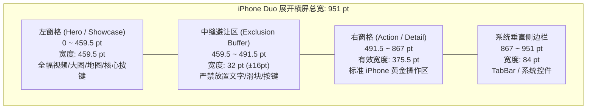

# iPhone Duo (Foldable) Design & Engineering Guide

### 📱 iPhone Duo 折叠屏设计与研发适配

[](https://developer.apple.com)
[-orange.svg)](https://www.apple.com)
[](https://github.com/mirzaaghazadeh/iphone-duo-skills)
[](https://swift.org)
[](https://developer.apple.com)
[](LICENSE)

> 本指南基于 Apple iOS 27.1 折叠屏人机交互规范，深度融合官方权威技能生态 [mirzaaghazadeh/iphone-duo-skills](https://github.com/mirzaaghazadeh/iphone-duo-skills)（涵盖布局、转轴、垂直导航、相机与设计审查等 11 项全套指南），并经过商业化产品生产环境严苛验证。旨在为 iOS 研发团队与 UI/UX 设计师提供一套**已脱敏、开箱即用、高拓展性**的通用适配基座。

---

## 📖 目录 (Table of Contents)

- [1. 为什么需要专属的 Duo 适配方案？](#1-为什么需要专属的-duo-适配方案)
- [2. 硬件规格与屏幕度量 (Hardware & Geometry)](#2-硬件规格与屏幕度量-hardware--geometry)
  - [2.1 物理像素与逻辑点数规格表](#21-物理像素与逻辑点数规格表)
  - [2.2 核心几何度量与 84pt 避让](#22-核心几何度量与-84pt-避让)
- [3. 产品与 UI/UX 设计准则 (Design Principles)](#3-产品与-uiux-设计准则-design-principles)
  - [3.1 核心设计铁律](#31-核心设计铁律)
  - [3.2 五大经典双屏设计模式](#32-五大经典双屏设计模式)
- [4. 通用工程架构与扩展库 (Core Architecture & Extensions)](#4-通用工程架构与扩展库-core-architecture--extensions)
  - [4.1 屏幕度量与双窗格判定引擎 (`DuoDisplay.swift`)](#41-屏幕度量与双窗格判定引擎-duodisplayswift)
  - [4.2 控制器扩展便捷工具 (`UIViewController+Duo.swift`)](#42-控制器扩展便捷工具-uiviewcontrollerduoswift)
  - [4.3 双窗格通用基类控制器 (`DuoDualPaneBaseController.swift`)](#43-双窗格通用基类控制器-duodualpanebasecontrollerswift)
- [5. 典型通用场景实战案例剖析 (Universal Case Studies)](#5-典型通用场景实战案例剖析-universal-case-studies)
  - [案例 1：沉浸式媒体/新手引导 (Showcase & Action)](#案例-1沉浸式媒体新手引导-showcase--action)
  - [案例 2：商业化订阅与付费墙 (Two-Pane Paywall)](#案例-2商业化订阅与付费墙-two-pane-paywall)
  - [案例 3：核心控制与辅助看板 (Control & Companion)](#案例-3核心控制与辅助看板-control--companion)
  - [案例 4：底图画布与浮动抽屉 (Canvas & Floating Sheet)](#案例-4底图画布与浮动抽屉-canvas--floating-sheet)
- [6. 上线前自查清单 (Pre-flight Checklist)](#6-上线前自查清单-pre-flight-checklist)
- [7. 引用与生态 (Ecosystem & Reference)](#7-引用与生态-ecosystem--reference)
- [8. 开源共建与 License (Contributing)](#8-开源共建与-license-contributing)

---

## 1. 为什么需要专属的 Duo 适配方案？

iPhone Duo 是 Apple 推出的具有划时代意义的双屏折叠设备。许多团队误以为“支持 iPad 屏幕”或“支持 AutoLayout 约束”就能自动适应 Duo，但在实际业务中会遇到一系列破坏性体验：

1. **机械拉伸 (The Stretch Disaster)**：原本 375pt 的竖屏按钮在内屏展开后被暴力拉伸至 890pt+，形成巨大的横向“扁担按钮”，视觉与触控极不自然；
2. **中缝物理切断 (The Fold Cut)**：中央物理铰链折痕横穿核心点击控件、表单输入框、地图十字准星或滑动取消条，严重影响用户交互；
3. **竖屏视频/画幅被强行裁剪**：传统的 9:16 竖屏视频在内屏横向展开时，若采用全屏铺满（AspectFill），上下将被裁剪超过 60%，导致关键信息完全丢失；
4. **84pt 侧边垂直导航条遮挡 (Vertical TabBar)**：在折叠外屏及展开内屏横屏下，系统导航与标签栏将以 84pt 垂直形态驻留在屏幕右侧（Trailing），手搓导航栏或未对齐 `safeAreaLayoutGuide` 的内容将被彻底覆盖；
5. **付费墙与协议撕裂违规**：订阅购买大按钮与价格信息分处中缝两侧，或用户协议被挤压出屏，违背 App Store 审核准则（如 Guideline 3.1.2）。

**解决之道**：遵循“**每一半屏幕本质上就是一部独立手机**”的核心理念，采用左右双窗格（Dual-Pane）协同架构。

---

## 2. 硬件规格与屏幕度量 (Hardware & Geometry)

### 2.1 物理像素与逻辑点数规格表

iPhone Duo 内屏展开后的物理尺寸为 $164.6 \times 117.8\text{ mm}$，宽明显大于高，其**自然手持态为横屏 (Landscape)**。

| 设备形态                       | 屏幕方向                    | 物理像素 (px)              | 渲染逻辑点 (pt)        | 比例 (Aspect Ratio) | 尺寸类 (Size Class)          | 缩放因子           |
|:------------------------------ |:--------------------------- |:-------------------------- |:---------------------- |:------------------- |:---------------------------- |:------------------ |
| **折叠外屏 (Closed)**          | 竖屏 (Portrait)             | $1398 \times 2034$         | **$466 \times 678$**   | $\approx 1.45 : 1$  | Compact $\times$ Regular     | 3.0x               |
| **折叠外屏 (Closed)**          | 横屏 (Landscape)            | $2034 \times 1398$         | **$678 \times 466$**   | $\approx 1.45 : 1$  | Compact $\times$ Compact     | 3.0x               |
| **展开内屏 (Open Flat)**       | **横屏 (Landscape 自然态)** | $2670 \times 1878$         | **$951 \times 669$**   | $\approx 1.42 : 1$  | **Regular $\times$ Regular** | 3.0x (Downsampled) |
| **展开内屏 (Open Flat)**       | 竖屏 (Portrait)             | $1878 \times 2670$         | **$669 \times 951$**   | $\approx 1.42 : 1$  | Regular $\times$ Regular     | 3.0x (Downsampled) |
| **展开内屏单侧 (Single Half)** | 横屏下的单侧窗口            | $\approx 1335 \times 1878$ | **$475.5 \times 669$** | $\approx 1.41 : 1$  | 相当于标准 iPhone            | 3.0x               |

> [!NOTE]
> **黄金可用宽度 $375.5\text{ pt}$**：
> 在展开横屏（$951 \times 669\text{pt}$）下，右侧包含系统 84pt 垂直导航条，中缝保留 16pt 避让。
> 则右侧可用操作区宽度为：$$951 - 84 - (475.5 + 16) = \mathbf{375.5\text{ pt}}$$
> 这与行业最经典的 **$375\text{ pt}$ iOS 设计稿基准**（iPhone 6/7/8/X/12mini/13mini）在像素级上几乎完全吻合！

---

### 2.2 核心几何度量与 84pt 避让



* **中央物理折痕 (Hinge)**：位于渲染屏幕中央 **$x = 475.5\text{ pt}$**。
* **中缝避让缓冲区 (Exclusion Buffer)**：必须预留 **32 pt** 缓冲区（范围 $[459.5, 491.5]\text{ pt}$），确保任何交互按钮、文本标签或进度滑块都不会被中缝撕裂。
* **右侧垂直导航栏 (84pt Vertical Bar)**：
  * 折叠外屏竖屏：`safeAreaInsets.right = 84pt`，`bottom = 0pt`；
  * 展开内屏横屏：`safeAreaInsets.right = 84pt`，`bottom = 0~21pt`；
  * 约束规范：右侧所有根卡片必须锚定 `view.safeAreaLayoutGuide.trailing`，杜绝直接锁定 `view.trailing`。

---

## 3. 产品与 UI/UX 设计准则 (Design Principles)

### 3.1 核心设计铁律

1. **拒绝拉伸 (Don't Stretch)**：单半屏就是一部手机。内屏展开并非是将按钮拉长至 900pt，而是将副屏转变为辅助信息或上下文面板。
2. **媒体铺满，控件拆分 (Mask Media, Split Controls)**：连续型背景、地图底图或全景大图可跨越折痕铺满全屏；但按钮、开关、输入框等离散交互控件必须严格划分在左屏或右屏内。
3. **商业化闭环在单屏 (Two-Pane Paywall Rule)**：购买按钮、价格详情、订阅周期与法律合规条款，必须完整收纳在同一个窗格中，保证决策与操作的即时闭环。
4. **状态跨折叠保活 (State Survives the Fold)**：展开或折叠设备只发生布局几何变化，用户正在播放的音视频、表单输入中内容、网络加载态及导航栈不可被重置。
5. **黄金手势触控区收纳**：关键推进或紧急交互（如“继续”、“立即订阅”、“滑动取消”）应锚定在单侧窗格的下半部拇指触达区。

---

### 3.2 五大经典双屏设计模式

```
[模式 1: 叙事与转化]        [模式 2: 控制与联动]        [模式 3: 主从看板]
┌─────────┬─┬─────────┐   ┌─────────┬─┬─────────┐   ┌─────────┬─┬─────────┐
│         │ │ 标题    │   │         │ │ 实时    │   │ 概览    │ │ 列表    │
│ 全景视频 │折│ ────── │   │ 核心    │折│ 数据    │   │ 筛选    │折│ 明细    │
│ 或画廊  │痕│ [选项] │   │ 操作盘  │痕│ ────── │   │ ──────  │痕│ ────── │
│ 沉浸展示 │ │ [按钮] │   │ 撤销条  │ │ 状态卡  │   │ 地图    │ │ 时间线  │
└─────────┴─┴─────────┘   └─────────┴─┴─────────┘   └─────────┴─┴─────────┘

[模式 4: 画布与浮动抽屉]     [模式 5: 个人与设置]
┌─────────────────────┐   ┌─────────┬─┬─────────┐
│     全屏底图画布      │   │ 个人    │ │ [设置]  │
│  (MapKit / OpenGL)  │   │ 档案    │折│ [安全]  │
│ ┌─────┐             │   │ 会员卡  │痕│ [协议]  │
│ │420pt│             │   │ ──────  │ │ ──────  │
│ └─────┘             │   │ 概况信息 │ │ 客服入口│
└─────────────────────┘   └─────────┴─┴─────────┘
```

1. **叙事与转化 (Showcase + Action)**：左屏负责视觉与情感沉浸（9:16 全画幅视频/原图轮播），右屏负责参数选择与决策转化（选项卡片、CTA 按钮、隐私协议）。
2. **控制与联动 (Control + Companion)**：左屏固定核心指令（主操作盘、倒计时、常驻手势取消滑块），右屏承载辅助联动看板（实时状态、受影响节点清单、定位底图）。
3. **主从看板 (Master-Detail)**：左屏负责宏观维度筛选（日历、大分类、全局热力图），右屏负责纵深时间轴与详细记录。
4. **画布与浮动抽屉 (Canvas + Floating Sheet)**：地图延伸至全屏底图，底部弹出式抽屉在展开横屏下自动收敛为 420pt 浮动卡片（居左下角，带圆角与投影），右侧地图区域完整露开展开自由交互。
5. **个人与设置 (Profile + Menu)**：左屏承载个人档案卡与核心资产看板，右屏呈现系统设置、安全中心与常驻客服悬浮胶囊。

---

## 4. 通用工程架构与扩展库 (Core Architecture & Extensions)

为了方便设计与工程团队无侵入式接入，本方案提供完全解耦的 3 层工具包：

### 4.1 屏幕度量与双窗格判定引擎 (`DuoDisplay.swift`)

无需依赖第三方或业务私有单例，纯 Swift 编写的通用设备状态判定工具：

```swift
import UIKit

/// 通用 iPhone Duo 与双屏展开状态判定引擎
public enum DuoDisplay {
    
    /// 中央物理铰链折痕的 X 轴物理坐标点 (内屏横屏 951pt 时为 475.5pt)
    public static let hingeCenterThreshold: CGFloat = 475.5
    
    /// 官方推荐折痕单边安全避让间距 (中缝总宽度预留 32pt)
    public static let hingeBufferOffset: CGFloat = 16.0
    
    /// 右侧垂直导航栏固定宽度
    public static let verticalBarWidth: CGFloat = 84.0
    
    /// 浮动抽屉推荐黄金宽度
    public static let floatingSheetWidth: CGFloat = 420.0

    /// 是否处于 Duo 展开横屏（或大屏双窗格）有效状态
    public static func isDualPaneLandscape(
        size: CGSize? = nil,
        traitCollection: UITraitCollection? = nil
    ) -> Bool {
        let currentSize = size ?? (activeWindow?.bounds.size ?? UIScreen.main.bounds.size)
        let isLandscape = currentSize.width > currentSize.height
        
        let tc = traitCollection ?? activeWindow?.traitCollection
        let isRegular = tc?.horizontalSizeClass == .regular
        
        // 阈值说明:
        // 标准 iPhone (如 16 Pro Max 横屏为 440pt 宽) 不应触发双窗格
        // Duo 外屏横屏为 678pt (Compact)，展开内屏横屏为 951pt (Regular)
        let isWide = currentSize.width >= 700 || (currentSize.width >= 600 && isRegular)
        return isLandscape && isWide
    }

    /// 获取当前活跃的 KeyWindow
    public static var activeWindow: UIWindow? {
        UIApplication.shared.connectedScenes
            .compactMap { $0 as? UIWindowScene }
            .flatMap { $0.windows }
            .first { $0.isKeyWindow }
    }
}
```

---

### 4.2 控制器扩展便捷工具 (`UIViewController+Duo.swift`)

在控制器层提供一键式计算与安全区辅助：

```swift
import UIKit

public extension UIViewController {
    
    /// 判断当前控制器视图是否处于双窗格展开横屏
    func isDualPaneLandscape(for targetSize: CGSize? = nil) -> Bool {
        return DuoDisplay.isDualPaneLandscape(
            size: targetSize ?? view.bounds.size,
            traitCollection: traitCollection
        )
    }
    
    /// 获取真实右侧安全区边距 (自动兼容 84pt 垂直导航栏)
    var effectiveTrailingMargin: CGFloat {
        let safeTrailing = view.safeAreaInsets.right
        return max(safeTrailing, 16.0)
    }
}
```

---

### 4.3 双窗格通用基类控制器 (`DuoDualPaneBaseController.swift`)

基于原生 `UILayoutGuide` 搭建的轻量级虚拟容器模板，天然支持旋转动画平滑过渡：

```swift
import UIKit

/// 通用自适应双窗格基类控制器
open class DuoDualPaneBaseController: UIViewController {

    /// 左窗格引导区域 (0 ~ 459.5pt)
    public let leftPaneGuide = UILayoutGuide()
    /// 右窗格引导区域 (491.5 ~ 867pt)
    public let rightPaneGuide = UILayoutGuide()

    /// 当前是否处于双窗格状态
    public private(set) var isCurrentlyDualPane: Bool = false

    open override func viewDidLoad() {
        super.viewDidLoad()
        view.backgroundColor = .systemBackground
        setupPaneGuides()
        setupSubviews()
        updateLayoutConstraints(isDualPane: isDualPaneLandscape())
    }

    private func setupPaneGuides() {
        view.addLayoutGuide(leftPaneGuide)
        view.addLayoutGuide(rightPaneGuide)
    }

    /// 子类重写：添加子视图并建立初始通用关系
    open func setupSubviews() {
        // 由子类实现
    }

    /// 子类重写：在双窗格与标准单列布局之间切换约束
    open func updateLayoutConstraints(isDualPane: Bool) {
        self.isCurrentlyDualPane = isDualPane

        if isDualPane {
            // MARK: - Duo 展开横屏左右双窗格
            leftPaneGuide.snp.remakeConstraints { make in
                make.leading.equalTo(view.safeAreaLayoutGuide.snp.leading).offset(24)
                make.trailing.equalTo(view.snp.centerX).offset(-DuoDisplay.hingeBufferOffset)
                make.top.bottom.equalTo(view.safeAreaLayoutGuide)
            }

            rightPaneGuide.snp.remakeConstraints { make in
                make.leading.equalTo(view.snp.centerX).offset(DuoDisplay.hingeBufferOffset)
                make.trailing.equalTo(view.safeAreaLayoutGuide.snp.trailing).offset(-16)
                make.top.bottom.equalTo(view.safeAreaLayoutGuide)
            }
        } else {
            // MARK: - 标准单屏全宽流式布局
            leftPaneGuide.snp.remakeConstraints { make in
                make.edges.equalTo(view.safeAreaLayoutGuide)
            }
            rightPaneGuide.snp.remakeConstraints { make in
                make.edges.equalTo(view.safeAreaLayoutGuide)
            }
        }
    }

    // MARK: - 屏幕尺寸与旋转自适应监听
    open override func viewWillTransition(
        to size: CGSize,
        with coordinator: UIViewControllerTransitionCoordinator
    ) {
        super.viewWillTransition(to: size, with: coordinator)
        let isDual = isDualPaneLandscape(for: size)
        
        coordinator.animate { [weak self] _ in
            self?.updateLayoutConstraints(isDualPane: isDual)
            self?.view.layoutIfNeeded()
        }
    }

    open override func viewDidLayoutSubviews() {
        super.viewDidLayoutSubviews()
        let shouldBeDual = isDualPaneLandscape()
        if isCurrentlyDualPane != shouldBeDual {
            updateLayoutConstraints(isDualPane: shouldBeDual)
        }
    }
}
```

---

## 5. 典型通用场景实战案例剖析 (Universal Case Studies)

### 案例 1：沉浸式媒体/新手引导 (Showcase & Action)

* **典型场景**：欢迎页、功能介绍流、视频演示页。
* **痛点根因**：原先采用单一纵向视图，横屏展开时 9:16 竖屏视频被等比放大至 951pt，关键演示主体上下被截断 60%，底部遮罩覆盖整个画面。
* **解决方案**：
  * **左窗格 (Showcase)**：视频播放器独占 $0 \sim 475.5\text{ pt}$，保持原始 9:16 宽高比渲染，零裁剪；同时动态移除底部渐变黑色阴影。
  * **右窗格 (Action)**：使用淡雅背景托底，居中排布 34pt 主标题、步骤指示副标题，底部常驻 340pt 标准宽度推进按钮与步骤分页指示器。

---

### 案例 2：商业化订阅与付费墙 (Two-Pane Paywall)

* **典型场景**：VIP 会员订阅、应用内购买 (IAP) 落地页。
* **痛点根因**：多卡片流在宽屏下拉长撕裂，购买大按钮在中缝正中被物理折痕切断，无法满足 Apple 审核指南对“价格、条款、恢复按钮同屏闭环”的合规要求。
* **解决方案**：
  * **左窗格 (Brand & Mood)**：全高轮播产品场景大图，左上角提供半透明轻量关闭按钮（X），关闭底部白色渐变羽化效果。
  * **右窗格 (Paywall Payload)**：有效可用宽度恰为 $375.5\text{ pt}$（与标准设计图 100% 对齐）。垂直排布特权白卡、产品选卡（周/年/终身）、明确的价格提示、CTA 订阅大按钮及法律协议超链接，右上角常驻“恢复订阅”入口。

---

### 案例 3：核心控制与辅助看板 (Control & Companion)

* **典型场景**：紧急告警、设备连接与控制、倒计时任务。
* **痛点根因**：用户在滑动取消（Slide-to-Cancel）时，手指必须划过凹陷的物理铰链，体验生硬且易导致手势中断。
* **解决方案**：
  * **左窗格 (Master Control)**：承载 180×180pt 脉冲主状态盘、核心倒计时，并将**手势滑块控件吸底固定于左窗格下沿**，单手拇指即可在单侧平整玻璃上顺畅完成手势。
  * **右窗格 (Companion View)**：承载关联受影响清单、网络通知触达状态列表以及微缩状态指示卡片。

---

### 案例 4：底图画布与浮动抽屉 (Canvas & Floating Sheet)

* **典型场景**：地图导航、画板标注、日程大看板。
* **痛点根因**：全屏底部抽屉在宽屏下铺满底部，遮挡了 70% 的地图视野。
* **解决方案**：
  * 地图或主画布横跨左右全屏展示；
  * 底部抽屉在检测到 `isDualPaneLandscape` 时，收敛为 **420pt 黄金宽度**的独立浮动面板，锚定在屏幕左下角（留出 16pt 边距，带 16pt 圆角与自然阴影），右侧画布完整露开展开流畅交互。

---

## 6. 上线前自查清单 (Pre-flight Checklist)

在设计评审或代码 PR 提交前，请逐项核对：

| 序号  | 检验维度              | 关键检查点                                      | 合格判定标准                                                |
|:-----:|:--------------------- |:----------------------------------------------- |:----------------------------------------------------------- |
| **1** | **物理折痕避让**      | $x = 475.5\text{ pt} \pm 16\text{ pt}$ 区域排查 | 没有任何离散按钮、文字、滑块或核心图标跨越中缝              |
| **2** | **84pt 垂直导航避让** | 右侧外边缘布局约束                              | 约束绑定 `safeAreaLayoutGuide.trailing`，右边缘无内容被遮盖 |
| **3** | **控件抗拉伸控制**    | 展开横屏下按钮与卡片尺寸                        | 单个操作按钮宽度控制在 320~440pt 之间，杜绝 900pt 机械扁担  |
| **4** | **商业化合规闭环**    | Paywall 界面价格、购买点与协议                  | 价格、订阅周期、购买按钮和法律条款完整收纳在单侧窗格        |
| **5** | **外屏平滑降级**      | 设备折叠闭合状态 ($466 \times 678\text{pt}$)    | 界面平滑回退为标准单列流布局，无元素重叠或截断              |
| **6** | **折叠与旋转保活**    | 在模拟器中切换姿态 (`Cmd + [` / `Cmd + ]`)      | 音视频播放进度、表单输入中内容、滚动偏移行平滑保留          |

---

## 7. 引用与生态 (Ecosystem & Reference)

本指南深度依托并兼容以下开源生态与技术规范：

* 📱 **Official Duo Skills Library**: [mirzaaghazadeh/iphone-duo-skills](https://github.com/mirzaaghazadeh/iphone-duo-skills)
  * `iphone-duo-readiness`: 折叠屏迁移全景审计与入口
  * `iphone-duo-adaptive-layout`: 预留区域、中缝避让与双容器布局
  * `iphone-duo-vertical-bars`: 84pt 垂直侧边栏与动态适配
  * `iphone-duo-dual-pane-patterns`: 双窗格设计模式与点数规格
  * `iphone-duo-hinge-and-scenes`: 物理铰链角度动效与多窗口协同
  * `iphone-duo-design-review`: 人机交互与体验设计审查准则
* 🍏 **Apple Human Interface Guidelines**: [Foldable Device Layout Guidelines](https://developer.apple.com/design/human-interface-guidelines)
* 📐 **Layout Engine**: [SnapKit / AutoLayout](https://github.com/SnapKit/SnapKit)

---

## 8. 开源共建与 License (Contributing)

欢迎提交 Issue 和 Pull Request 一同完善 iPhone Duo 折叠屏设计与开发生态！

1. Fork 本仓库并新建分支
2. 保持代码注释规范并遵循 Apple HIG；
3. 提交 PR 并附带 Xcode 27+ 模拟器双屏录屏效果。

本项目采用 [MIT License](LICENSE) 授权许可。
